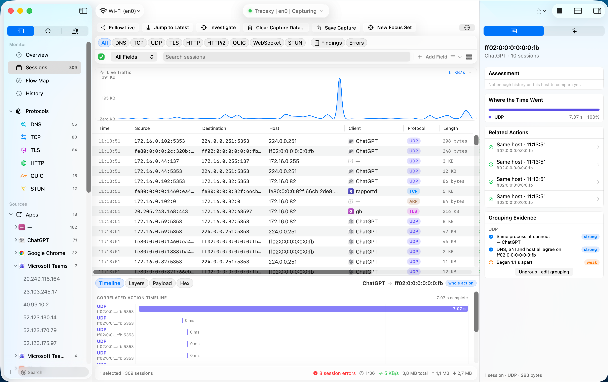
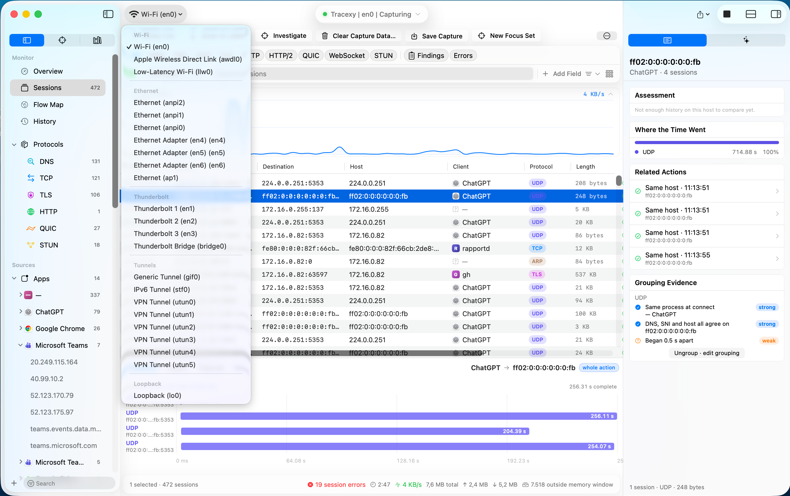
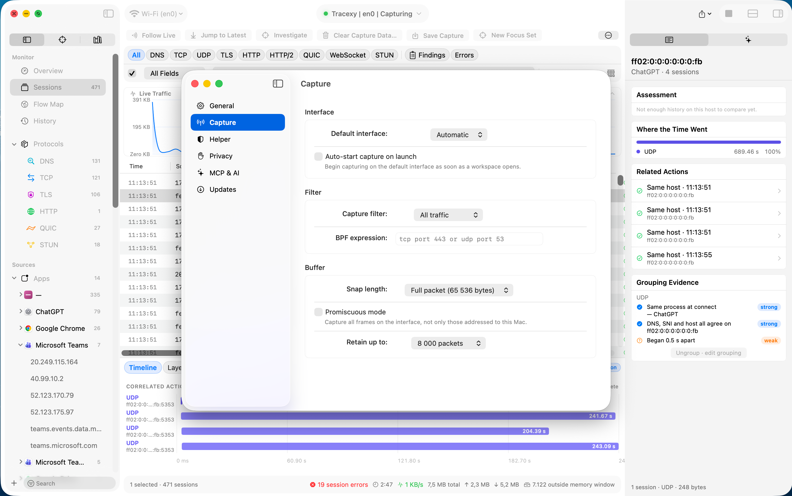
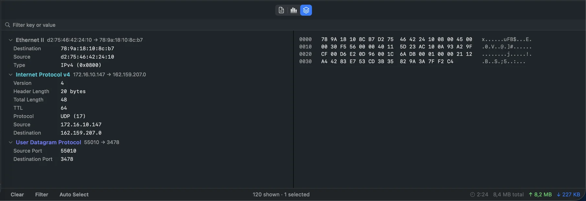

<p align="center">
  
</p>

<h1 align="center">Tracexy</h1>

<p align="center">
  <strong>A native, session-first Wireshark alternative for macOS.</strong>
</p>

<p align="center">
  Native macOS network intelligence, organized around sessions—not packet noise.<br>
  Capture live traffic or open a saved capture, then investigate hosts, processes, protocols,
  timing, and raw packet evidence in one local-first workspace.
</p>

<p align="center">
  <sub>The AGPL-licensed public source edition of Tracexy for macOS.</sub>
</p>

<p align="center">
  <a href="https://github.com/RockxyApp/Tracexy/actions/workflows/build.yml"></a>
  
  
  
  <a href="LICENSE"></a>
  <a href="CONTRIBUTING.md"></a>
</p>

---

<!-- BEGIN GENERATED: latest-release -->
## Latest Tagged Release

**v0.10.0** — 2026-11-13

### Added

- Import a text hex dump from File → Import Hex Dump…, with an explicit offset base, byte grouping, regular-expression scopes for packet bytes, timestamps, direction and sequence numbers, a chosen link type, and optional generated Ethernet, IPv4/IPv6, UDP, TCP or SCTP headers around entered payload bytes.
- Export the frames you chose: an exact selected-frame capture, every frame matching an applied Frame Expression, and an opt-in that leaves ignored frames out of the written file.
- Export packet dissections as text summaries, details and captured bytes, as JSON with optional raw hex for exactly mapped fields, or as a summary CSV that can add up to four applied Project field columns.
- Print packet summaries, decoded dissections or captured-byte hex dumps for the sessions in view, one frame, marked frames, a numeric frame range, or every frame matching an applied Frame Expression.
- Filter All Frames with a bounded Frame Expression over typed frame facts, including capture direction, inner tunnel addresses, TCP control flags and raw sequence/acknowledgement values, IPv4 Identification, Don't Fragment, TTL and fragment offsets, IPv6 hop limits, DNS transaction IDs and the TC flag, and ICMP/ICMPv6 type and code.
- Build Frame Expressions straight from the decode tree: copy a field as a filter term, highlight matching frames temporarily, or prefill a supported predicate for review before you apply it.
- Colorize packets with ordered Project-local coloring rules, up to ten capture-local conversation color slots, and an import that accepts Wireshark JSONC and legacy `colorfilters` records whose filters fit Tracexy's grammar; unsupported rules are reported rather than silently dropped.
- Resolve addresses from more sources: name an address from an All Frames row, merge a bounded standard or Wireshark `hosts` file, and read PCAPNG Name Resolution Blocks when a capture carries them, with omitted records reported in Capture Info.
- Correct the time of a saved capture in memory with a whole-capture offset, one anchor, or two anchors for linear drift, with Undo; sessions, findings, timelines, All Frames and Follow views recompute from the same correction, and supported exports carry it with its provenance.
- Set capture-wide time references in All Frames that survive paging and display filters, add a Cumulative Bytes column that resets at each reference, and keep up to sixteen temporary references per scope.
- Compare up to four named Frame Expression series in the I/O Graph over one pass of a stable capture, with per-series match, unknown and untimed coverage, CSV and chart-image export, and a jump from a chart interval to a representative matching frame.
- Read more TCP evidence in Session Health: receiver-reported SACK ranges, RFC 2883 D-SACK ranges shown as the receiver's report rather than a cause, SACK-aware Goodput beside wire throughput, a conservative SACK-reported RTT line beside Karn-safe RTT, and typed window-update and zero-window probe observations.
- Navigate and search a capture more directly: Frame Expression Find, UTF-8 and UTF-16 string search, bounded Back/Forward selection history, First/Last on the current page, pinned rows that persist across paging, Mark and Ignore All Displayed, and a frame-scoped details tree for a frame with no folded session.
- Filter, expand, copy and keyboard-navigate decoded layer trees in both the Session Inspector and standalone frame details, including a visible-subtree copy that honors what is folded.
- Follow conversations with more honest export: attributed TCP source chunks with per-peer indexes, direction-scoped UDP transcripts, raw payload export when completeness checks pass, and disabled bidirectional actions with a stated reason when retained provenance cannot prove cross-direction order.
- Override decoding per Project with TCP/UDP port rules prefilled from the packet list or packet details for review, and pass invocation-local `--decode-as` rules to the read-only command line without touching Project settings.
- Stream frame tables from the command line with `tracexy frames`, including capture direction and repeated `--column Protocol:Field` for supported decoded fields.
- Read SCTP common headers, verification tags and bounded chunk headers, validate CRC32C when the declared packet boundary is fully captured, and import SCTP chunks or payload bytes from a hex dump.
- See SCTP traffic as sessions: flows fold on their endpoint pair with directional packets and bytes, an SCTP tab joins Conversations and Endpoints (`--tap conv,sctp`, `--tap endpoints,sctp`), an observed INIT chunk names the side that opened the association, and an observed ABORT marks the session as an error. Sessions are keyed on the endpoint pair, not the verification tag, and SCTP streams are still not reassembled. An SCTP pill joins the session filter pills, so a capture that mixes SCTP with other transports can be narrowed to it, and `sctp` is a Session Expression protocol term like `tcp` and `udp`, so Help ▸ Supported Protocols, expression completion and the `sctp` and `sctp port` display-filter imports all name it.
- Rescan one TCP conversation on a stable source for deeper graph evidence, and see SMB2, LDAP, Kerberos, ICMP and ICMPv6 service response times over the complete capture in the window and the command line.

### Fixed

- A Frame Expression typed in All Frames applies when you press Return, and the field shows its grammar in a tooltip again.
- Exported and printed packet dissections carry a saved capture's Time Shift, so their times match All Frames instead of the uncorrected source.
- Go to Packet on a pinned frame now says when that frame is outside the capture in view, instead of doing nothing. A frame named by Find before any page has been listed now lists the page that would hold it rather than being refused.
- The first frame on a later All Frames page shows its real time delta from the frame before it, taken from the same scan that built the page, instead of an unknown delta. A filtered page whose opening frame is hidden, and a time reference pinned from another page, still report unknown rather than borrowing that time.
- Split Capture and the capture file-set settings now name the menu that walks a file set correctly, File ▸ File Set ▸ Next File, in English and Vietnamese. The old text named an item that does not exist.
- Overview's Measure and Series chart choices are kept per Project instead of being shared by every Project on this Mac, including a Synthetic Project. Both reset to their defaults once, because they move to a Project-owned setting.
- The All Frames footer reads `Showing 37 of frames 200,001–400,000, 500,000 scanned` rather than repeating "of" twice, and it is now translated.
- The All Frames expression field and its Highlight button are no longer drawn hard against the window edge with their leading corners clipped.
- The All Frames footer no longer truncates its own commands to "Mark All Di…" and "Unignore D…" at the window's ordinary width: the bulk mark and ignore commands share a Marks menu, the export and print commands an Export menu, and each is unavailable when it has nothing to act on. The Relative TCP Seq/Ack toggle reads on one line again instead of three.
- The IP Statistics and Service Response Time choosers sit under the titlebar instead of floating down the middle of an otherwise empty window.
- The Packet Lengths, Resolved Addresses, Protocol Hierarchy and Message Counts footers stay on one line at any window width; a caption that used to stop mid-clause now states the fact and names the bound it counts to in its tooltip.
- Decode As shows its rule-limit and redecode notices on their own line, so its buttons stay reachable on one line when a draft, the rule limit and a pending redecode coincide. Overview's chart notices stack for the same reason.
- Manage Interfaces opens at the size it declares rather than clamped to its minimum with the interface columns already squeezed.

### Changed

- TCP acknowledgement, window and checksum values, IPv4 Identification and fragment flags, and DNS transaction ID and TC flags now appear in the packet inspector and can be filtered.
- All Frames pages through a stable capture with a stated retained-row limit, so Frame Expression match counts describe the whole capture while toolbar search stays page-local.
- Settings → Privacy now states that all data stays on this Mac and that no usage analytics are collected, in place of two checkboxes that could not change either: Tracexy has no upload path and ships no analytics collection.

See [CHANGELOG.md](CHANGELOG.md) for the full release history.
<!-- END GENERATED: latest-release -->

Tracexy is an open-source network intelligence app built specifically for macOS. It captures traffic
passively and turns frames into explainable sessions and correlated activities: which process
contacted which host, which protocols appeared, how much data moved, and what evidence supports the
grouping.

The main experience is session-first. Raw protocol fields and hex remain one click away when the
bytes are the answer, but they do not dominate the workspace.

> [!IMPORTANT]
> This repository contains Tracexy's public source edition under
> [AGPL-3.0-or-later](LICENSE). Builds made solely from this repository are AGPL builds.
> Rockxy LLC may also offer official binaries, support, enterprise rights, hosted services, or
> downstream distributions under separate commercial terms. Those terms apply only to the copy,
> service, or distribution that presents them; they do not remove the AGPL rights granted for this
> public source edition. Third-party components remain under their own licenses; see
> [Licensing](#licensing) below.

## Part of the Rockxy Ecosystem

Tracexy is part of the [Rockxy ecosystem](https://github.com/RockxyApp/Rockxy), a family of native,
local-first tools for understanding and controlling software and network behavior. The products
have distinct jobs and separate repositories, while sharing a focus on transparent evidence,
explicit data boundaries, and native platform experiences:

- **[Rockxy](https://github.com/RockxyApp/Rockxy)** — intercept, inspect, and modify HTTP, HTTPS,
  WebSocket, GraphQL, and other application traffic.
- **Tracexy** — passively capture network traffic and organize it into explainable sessions,
  protocol observations, and evidence-linked investigation workflows.
- **[Shieldxy](https://github.com/RockxyApp/Shieldxy)** — application-aware network security,
  connection control, and policy-oriented visibility.

Tracexy complements the ecosystem rather than replacing any one tool: the application-level
debugger focuses on traffic control, while Tracexy focuses on passive network intelligence across
interfaces, processes, protocols, and session relationships.

## See Tracexy in action

<p align="center">
  <a href="https://rockxy.io/tracexy#demo">
    
  </a>
</p>

<p align="center">
  <em>From live capture to explainable sessions and packet-level evidence.</em>
</p>

<p align="center">
  
</p>
<p align="center"><em>Choose the interface and start from the traffic surface that matters.</em></p>

<p align="center">
  
</p>
<p align="center"><em>Control capture scope, filters, packet detail, and retention before traffic leaves the wire.</em></p>

<p align="center">
  
</p>
<p align="center"><em>Inspect decoded protocol fields alongside the raw bytes that support them.</em></p>


## Why Tracexy

- **Sessions before packets.** Bidirectional traffic is grouped by canonical five-tuple so one
  conversation stays together.
- **Explainable correlation.** Related DNS, TCP, TLS, and HTTP observations can be grouped into an
  activity with visible confidence and contested-attribution states.
- **Native investigation workflow.** The app uses SwiftUI and AppKit for a real macOS sidebar,
  table, toolbar, split views, inspectors, menus, keyboard behavior, and SF Symbols.
- **Isolated Projects.** Keep separate investigations with their own workspaces, saved captures,
  History, filters, and capture and privacy settings.
- **Evidence stays available.** Summaries lead to decoded layers, field ranges, and raw hex without
  leaving the selected session.
- **Honest unknowns.** Missing process, hostname, protocol, or timing evidence is shown as unknown;
  Tracexy does not manufacture telemetry.
- **Local-first by design.** Captured frames and derived session data stay on the Mac unless the
  user explicitly exports a capture.

## What works today

| Area | Available now |
|---|---|
| **Capture** | Live libpcap capture through a privileged helper; interface discovery; bounded frame buffering; autostop and file-set (rotating) capture; PCAP/PCAPNG read/write; managed gzip, LZ4, TCP Viewer archive, and Linux cooked capture import; merge, split, and address-replacing export |
| **Decode** | Ethernet (VLAN), loopback, GRE/VXLAN and tunnel framing; ARP; IPv4/IPv6; ICMP/ICMPv6; TCP/UDP; DNS/mDNS, DHCP, NTP, TLS, HTTP/1 requests and responses, STUN, and QUIC summaries |
| **Sessions** | Direction-normalized five-tuple grouping, byte/timing summaries, bounded TCP lifecycle and sequence evidence, and higher-level activity correlation |
| **Investigation** | Overview, session table, flow map, scoped search, Session Expressions, evidence-linked findings, ladder and TCP health charts, response times, bounded Follow Stream, Protocol Hierarchy, DNS Lookups (with encrypted-DNS recognition), Message Counts, decoded fields, hex evidence, notes, and tags |
| **History** | Local SQLite terminal capture/session summaries with bounded reads, explicit refresh, confirmed clear, and no packet-payload persistence |
| **Automation** | Read-only History projections (captures, sessions, findings) with minimum disclosure; a bundled read-only MCP stdio tool; a read-only `summary` / `sessions` / `findings` command line built into the app binary; no network listener |
| **Workspace** | Native sidebar, independent workspace tabs, vertical or bottom inspector layouts, status/footer surfaces, Focus Sets, and Noise Control |
| **Projects** | Isolated investigations with separate workspaces, saved-capture Library, History, capture/privacy settings, and configuration-only import/export |
| **Attribution** | Best-effort process ownership from `pktap` metadata with a local socket-to-process fallback |
| **Languages** | English and Vietnamese |

## Comparison at a glance

Tracexy is not a Wireshark clone or a TLS interception proxy. It is strongest when a Mac
investigation needs app-aware sessions, local packet evidence, and a support-ready handoff without
claiming decrypted HTTPS visibility. The full maintained matrix is in
[docs/comparison.md](docs/comparison.md).

| Decision point | Tracexy | Wireshark | tcpdump | TShark | Packet | Cocoa Packet Analyzer |
|---|---|---|---|---|---|---|
| **Primary workflow** | Native macOS, session-first packet evidence with app/process context | Deep protocol dissection and broad packet-analysis workflow | Small command-line capture primitive | Wireshark dissection and field output in a terminal | Friendly native Mac traffic view | Native Mac packet/trace analyzer |
| **Source/license posture** | AGPL-3.0-or-later public source; separate commercial terms may exist for official distributions | Public open-source project | Public open-source command-line tool | Public open-source Wireshark command-line tool | closed source or no public information | closed source or no public information |
| **Live capture** | Live libpcap capture through a narrow privileged helper | Live interface capture | Live interface capture from terminal | Live capture from terminal | Native Mac live traffic workflow, depth requires vendor verification | Capture workflow requires vendor verification |
| **App/process attribution** | Core workflow when macOS context is available; unknown stays unknown | Possible through capture context, not the central workflow | Depends on capture context and surrounding tools | Available only if fields/capture context expose it | Per-app usage is publicly positioned, implementation depth requires vendor verification | Not a central verified claim |
| **TLS and HTTPS payloads** | TLS metadata only; no TLS interception, no decryption, no encrypted HTTP body visibility | Packet visibility depends on keys, capture point, and protocol conditions | Captures bytes; no HTTP interception workflow | Same packet-analysis boundary as Wireshark | Not positioned as an HTTPS interception proxy | Packet-analyzer boundary; no verified HTTPS interception claim |
| **Best aligned user** | Mac developer/support/security workflow that needs app-aware packet evidence without decrypting traffic | Protocol engineer or analyst needing maximum dissector depth | Operator collecting traffic quickly on a terminal or remote system | Analyst automating Wireshark-style dissection | Mac user wanting a friendly traffic view | Mac user wanting a native packet/trace analyzer |

## Protocol coverage

Application-layer decoding is intentionally metadata-focused in the current implementation. The always-on fold
recovers only bounded initial TLS/HTTP/DNS metadata; an explicit Follow Stream action can rescan a
stable saved or stopped source without turning the capture path into an unbounded stream store.

| Layer | Coverage | Important limits |
|---|---|---|
| **Link / network** | Ethernet II, BSD loopback/null, raw/tunnel IP, ARP, IPv4 options, IPv6 extension headers, ICMP/ICMPv6 | Partial decode is returned for malformed or truncated input |
| **Transport** | TCP flags/options, lifecycle and bounded sequence evidence; UDP endpoints | No general always-on TCP stream/record analyzer |
| **DNS** | Questions, compression pointers, and common answer records including A, AAAA, CNAME, MX, TXT, SRV, and SOA | No DNSSEC analysis |
| **TLS** | Record and handshake metadata, offered/chosen versions, cipher information, SNI, and ALPN | No decryption, certificates, or application data |
| **HTTP/1** | Request line and `Host`; response status and the headers that explain it (credentials only named as present); on-demand request↔response pairing, timing and body saving in Follow Stream | No HTTP/2 or HTTP/3; bodies only on demand from a stable source, never decompressed |
| **QUIC** | Long-header identification on UDP/443 | No frame or payload decode |

See the [source-grounded protocol matrix](docs/protocol-support.md) for exact field coverage.

## Current boundaries

These are deliberate statements of present capability, not hidden roadmap promises:

- No TLS or QUIC decryption.
- No general always-on TCP reassembly or typed record-analyzer framework; connection evidence and explicit bounded Follow Stream are narrower mechanisms.
- No deep HTTP/2, HTTP/3, or WebSocket decoder.
- History persists terminal capture/session summaries, not a raw-packet capture database.
- Findings are selected evidence-linked local observations, not a comprehensive durable security engine.
- A free, read-only MCP stdio executable exposes four bounded History tools (captures, sessions, findings) for one explicitly granted Project; it opens no listener and exposes no capture control or raw frames.
- The in-app AI Assistant sends a reviewed, bounded selected-session brief only to a validated local model endpoint. Remote/BYOK providers are not implemented in this Community checkout.
- Protected `.tracexysession` export enforces payload/metadata protections; raw pcap/pcapng stays byte-preserving. History retention is boundary-triggered rather than a periodic background scheduler.

## Privacy and security

Network captures can contain credentials, private hostnames, personal messages, and application
payloads. Tracexy treats them as sensitive by default.

- Captured traffic and derived sessions remain local; Tracexy does not upload capture payloads.
- Live capture starts when the user presses **Start**. If the user explicitly enables
  **Auto-start capture on launch**, that preference starts capture when the app opens.
- Opening `.pcap` or `.pcapng` files does not require the privileged helper or administrator access.
- Raw pcap/pcapng export preserves captured bytes and requires acknowledgement while protections are
  enabled. Protected `.tracexysession` export omits raw frames and sensitive decoded metadata according
  to the selected Privacy settings.
- Live capture crosses a narrow, typed XPC boundary with code-signing checks around the privileged
  helper.
- Signed update checks are separate from capture data and never include captured traffic.

Read [Privacy & security](docs/privacy-and-security.md) for the full trust model. Report
vulnerabilities privately through [SECURITY.md](SECURITY.md), not a public issue.

## Quick start

### Requirements

- macOS 14 or later
- Xcode 16 or later
- An Apple Developer Team for code-signing the app and helper

SwiftLint and SwiftFormat are optional for building, but required for contribution checks.

### Get the source

```bash
git clone https://github.com/RockxyApp/Tracexy.git
cd Tracexy
cp Configuration/Developer.xcconfig.template Configuration/Developer.xcconfig
open Tracexy.xcodeproj
```

Set your own Team ID in `Configuration/Developer.xcconfig`:

```text
TRACEXY_TEAM_ID = YOUR_TEAM_ID_HERE
CODE_SIGN_IDENTITY = Apple Development
DEVELOPMENT_TEAM = $(TRACEXY_TEAM_ID)
```

`Developer.xcconfig` is gitignored. Never commit your signing identity, certificates, provisioning
profiles, packet captures, or exported sessions.

Opening a saved capture is the quickest zero-helper path through the decode and session pipeline.
Live capture additionally requires one-time approval for the privileged helper in System Settings.

## Build and validate

```bash
# Build
xcodebuild -project Tracexy.xcodeproj -scheme Tracexy -destination 'platform=macOS' build

# Full app and UI test suite
xcodebuild -project Tracexy.xcodeproj -scheme Tracexy -destination 'platform=macOS' test

# Non-mutating style checks
swiftformat --lint .
swiftlint lint --strict
```

Changes to `TracexyCaptureHelper/` or the shared XPC protocol require uninstalling, rebuilding, and
reinstalling the helper; rebuilding the app alone does not hot-reload the privileged service.

Detailed setup and troubleshooting live in [Getting started](docs/getting-started.md).

## Architecture

```text
Capture  →  Protocol  →  Session  →  Workspace
```

| Layer | Source | Responsibility |
|---|---|---|
| **Capture** | `Tracexy/Core/Capture`, `TracexyCaptureHelper` | Live acquisition, capture-file IO, interface discovery, and capture statistics |
| **Protocol** | `Tracexy/Core/Protocol` | Bounds-checked packet access and stateless per-frame decoding |
| **Session** | `Tracexy/Core/Session` | Canonical conversation grouping, summaries, and activity correlation |
| **Workspace** | `Tracexy/Models`, `Tracexy/ViewModels`, `Tracexy/Views` | App policy, workspace state, orchestration, and native presentation |

The privileged helper exposes typed capture operations rather than arbitrary shell or file access.
Capture files and packet bytes are untrusted input: decoders return partial results or controlled
errors instead of reading beyond available data.

See [Architecture](docs/architecture.md) for the repository map, current seams, and known
transitional debt.

## Documentation

| Guide | Contents |
|---|---|
| [Documentation index](docs/README.md) | Current implementation status and navigation |
| [Getting started](docs/getting-started.md) | Build, signing, helper approval, and validation |
| [Usage](docs/usage.md) | Capture, sessions, correlation, filtering, and inspectors |
| [Architecture](docs/architecture.md) | Data flow, module boundaries, and repository map |
| [Protocol support](docs/protocol-support.md) | Exact decode coverage and limitations |
| [Privacy & security](docs/privacy-and-security.md) | Local-first posture and privileged trust boundary |
| [Competitor comparison](docs/comparison.md) | Source-backed positioning against packet-analysis alternatives |
| [Changelog](CHANGELOG.md) | Unreleased work and future tagged releases |

## Contributing

Bug reports, tests, documentation fixes, protocol fixtures, and focused pull requests are welcome.
Please read [CONTRIBUTING.md](CONTRIBUTING.md) before submitting a change.

For decoder work, include normal, truncated, and malformed-input coverage. Captures attached to an
issue must be reviewed and redacted first.

## Licensing

### Tracexy source

The source in this repository is licensed under the
[GNU Affero General Public License, version 3 or later (AGPL-3.0-or-later)](LICENSE).
AGPL is a strong copyleft license: you may run, study, modify, and redistribute Tracexy,
including commercially, as long as you follow its conditions.

In practical terms, redistributed modified versions must keep the license and required notices,
identify meaningful changes, and provide the corresponding source under AGPL terms. If a modified
version offers network interaction, AGPL section 13 also requires users who interact with it over
the network to be offered access to the corresponding source. The full legal terms, including the
no-warranty provisions, are in [LICENSE](LICENSE).

A build made solely from this repository is therefore an AGPL build. AGPL does not grant rights to
the Tracexy name, logo, or other trademarks.

### Commercial licensing and official binaries

Rockxy LLC may offer Tracexy, official binaries, support, enterprise rights, hosted services, private
distribution rights, or downstream distributions under separate commercial terms. See the
[Commercial Licensing Policy](legal/COMMERCIAL-LICENSING.md) and the draft
[Binary EULA](legal/BINARY-EULA-v1.0.md).

A commercial license applies only when Rockxy LLC grants it in writing or when an official
distribution presents the applicable agreement. Owning or using a commercially licensed copy does
not cancel the AGPL rights you have for a separate copy of the public source edition.

External contributions are accepted under the
[Tracexy Individual Contributor License Agreement](legal/cla/ICLA-v1.0.md) so accepted changes can
remain available in the public AGPL edition and also be used in separately licensed Tracexy
distributions. Organization-owned contributions require the
[Corporate Contributor License Agreement](legal/cla/CCLA-v1.0.md).

AGPL does not grant rights to use the Tracexy or Rockxy LLC names, logos, icons, domains, trade
dress, or other trademarks to identify a modified or redistributed product, except for truthful
nominative reference permitted by law.

### Third-party and platform components

Tracexy may link to third-party libraries and Apple system components, including the Sparkle update
framework. Those components are not relicensed by this repository and remain subject to their own
license terms and notices. Before distributing a build, review the licenses bundled by Xcode and the
dependency metadata in [`Package.resolved`](Tracexy.xcodeproj/project.xcworkspace/xcshareddata/swiftpm/Package.resolved).
